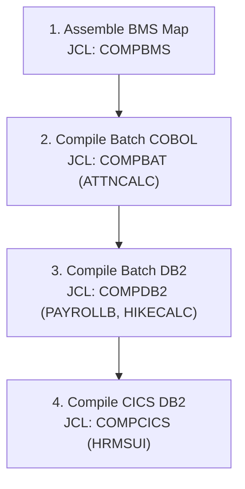

# Enterprise Mainframe HRMS: Beginner's Migration & Execution Guide

Welcome to the **Enterprise Mainframe HRMS** project! If you have **0 prior experience with IBM z/OS mainframes**, this guide was created specifically for you. It explains every concept in plain language and provides step-by-step instructions to copy, compile, deploy, and run this system on an IBM z/OS environment.

---

## Table of Contents
1. [Mainframe 101: Core Concepts Explained Simply](#1-mainframe-101-core-concepts-explained-simply)
2. [Prerequisites & Development Setup (VS Code + Zowe)](#2-prerequisites--development-setup-vs-code--zowe)
3. [Step 1: Allocating Datasets (PDS) on z/OS](#3-step-1-allocating-datasets-pds-on-zos)
4. [Step 2: Copying Files to z/OS PDS Members](#4-step-2-copying-files-to-zos-pds-members)
5. [Step 3: Database Setup via DB2 SPUFI](#5-step-3-database-setup-via-db2-spufi)
6. [Step 4: Defining and Loading VSAM Clusters](#6-step-4-defining-and-loading-vsam-clusters)
7. [Step 5: Compiling the Programs & BMS Map](#7-step-5-compiling-the-programs--bms-map)
8. [Step 6: CICS Deployment & 3270 Screen Testing](#8-step-6-cics-deployment--3270-screen-testing)
9. [Step 7: Running the Batch Processing Pipeline](#9-step-7-running-the-batch-processing-pipeline)
10. [Troubleshooting & Common Mainframe Errors](#10-troubleshooting--common-mainframe-errors)

---

## 1. Mainframe 101: Core Concepts Explained Simply

Before touching any code, here are the few fundamental concepts you need to know:

*   **High-Level Qualifier (HLQ):** In z/OS, file paths don't use folders like `C:\Users\...`. Instead, files are named with dot-separated qualifiers up to 44 characters, e.g., `IBMUSER.COBOL.SOURCE`. The first qualifier (`IBMUSER` or `YOUR.HLQ`) is your mainframe user ID.
*   **Dataset:** A file on the mainframe.
*   **Partitioned Dataset (PDS):** Think of a PDS as a **folder**, and each file inside it as a **member**. For example, `YOUR.HLQ.COBOL(HRMSUI)` means the member `HRMSUI` inside the PDS `YOUR.HLQ.COBOL`.
*   **Record Format (RECFM) & Logical Record Length (LRECL):**
    *   Mainframe text files are organized into fixed-length cards.
    *   **FB 80** means **Fixed Blocked, 80 characters per line**. Lines cannot exceed 80 characters.
*   **The 80-Column Rule in COBOL:**
    *   **Columns 1–6:** Sequence numbers (or blank spaces).
    *   **Column 7:** Indicator (`*` for comment).
    *   **Columns 8–11 (Area A):** Division headers, section names, paragraph names, `01` level records.
    *   **Columns 12–72 (Area B):** Executable statements (`MOVE`, `PERFORM`, `IF`, `EXEC SQL`, `05` level variables).
    *   **Columns 73–80:** Ignored by compiler (used for line tracking or blank).
*   **Job Control Language (JCL):** Mainframe script language used to run batch programs. Every JCL line starts with `//`.
*   **Return Codes (RC):**
    *   `RC = 0000` (Success)
    *   `RC = 0004` (Warning, usually safe)
    *   `RC = 0008` (Error, execution failed)
    *   `RC = 0012` or `0016` (Severe fatal error)
    *   `ABEND S0C7, S0C4` (Abnormal program termination crash)

---

## 2. Prerequisites & Development Setup (VS Code + Zowe)

You can work with z/OS either using a **3270 Terminal Emulator** or directly in **VS Code**:

### Option A: VS Code with Zowe Explorer (Recommended)
1. Install **Visual Studio Code**.
2. Install the **Zowe Explorer** extension from the VS Code Marketplace.
3. In the Zowe Explorer sidebar, click **+** to create a connection profile:
   * **Host:** Your z/OS IP or hostname (e.g., `mainframe.mycorp.com`).
   * **Port:** `443` or `10443` (z/OSMF REST API port).
   * **User:** Your mainframe RACF User ID (e.g., `IBMUSER`).
   * **Password:** Your mainframe password.
   * **Reject Unauthorized Certificates:** `false` (if using internal test SSL).
4. Test connection: You can now browse datasets, edit members, and submit JCL jobs directly from VS Code.

### Option B: 3270 Terminal Emulator
* Recommended free tools: **x3270**, **c3270**, or **Mocha TN3270**.
* Connect to your mainframe's IP and port `23` (or `992` for TLS).
* Log into **TSO/ISPF** with your user ID and password.

---

## 3. Step 1: Allocating Datasets (PDS) on z/OS

Before copying code, you must allocate the target Partitioned Datasets (PDS) on z/OS. 

### Dataset Allocation Table
Allocate the following datasets using **TSO 3.2 (Data Set Utility)** or via Zowe Explorer:

| Dataset Name | Record Format (RECFM) | Record Length (LRECL) | Block Size (BLKSIZE) | Dataset Type | Purpose |
|:---|:---:|:---:|:---:|:---:|:---|
| `YOUR.HLQ.DDL` | **FB** | **80** | **3120** | PDS (Directory Blocks = 10) | Database SQL Scripts |
| `YOUR.HLQ.COPYLIB` | **FB** | **80** | **3120** | PDS (Directory Blocks = 20) | COBOL Copybooks |
| `YOUR.HLQ.BMS` | **FB** | **80** | **3120** | PDS (Directory Blocks = 10) | 3270 Screen Maps |
| `YOUR.HLQ.COBOL` | **FB** | **80** | **3120** | PDS (Directory Blocks = 20) | COBOL Source Programs |
| `YOUR.HLQ.JCL` | **FB** | **80** | **3120** | PDS (Directory Blocks = 20) | Batch JCL Jobs |
| `YOUR.HLQ.DBRMLIB` | **FB** | **80** | **3120** | PDS (Directory Blocks = 20) | DB2 Precompiled DBRMs |
| `YOUR.HLQ.LOADLIB` | **U** | **0** | **32760** | **LIBRARY (PDSE)** | Compiled Executable Modules |

> [!TIP]
> **Allocation Parameters in TSO Option 3.2:**
> - Space Units: `TRACKS`
> - Primary Quantity: `15`, Secondary Quantity: `5`
> - Directory Blocks: `20` (use `LIBRARY` for Data Set Name Type for `LOADLIB`)

---

## 4. Step 2: Copying Files to z/OS PDS Members

Copy the local project files into their corresponding mainframe PDS members:

| Local Project File | Target z/OS PDS Member | Content Description |
|:---|:---|:---|
| `DDL/EMP_MASTER.sql` | `YOUR.HLQ.DDL(EMPMST)` | Relational table creation & seed data |
| `COPYBOOKS/EMPDCL.cpy` | `YOUR.HLQ.COPYLIB(EMPDCL)` | DB2 Host variables for EMP_MASTER |
| `COPYBOOKS/ATTNDREC.cpy` | `YOUR.HLQ.COPYLIB(ATTNDREC)` | Attendance swipe record layout (25B) |
| `COPYBOOKS/ATTNSUMM.cpy` | `YOUR.HLQ.COPYLIB(ATTNSUMM)` | Attendance summary layout (7B) |
| `COPYBOOKS/FINPAY.cpy` | `YOUR.HLQ.COPYLIB(FINPAY)` | Finance register layout (135B) |
| `COPYBOOKS/RATNGREC.cpy` | `YOUR.HLQ.COPYLIB(RATNGREC)` | Performance ratings feed layout (6B) |
| `COPYBOOKS/HRMSMAP.cpy` | `YOUR.HLQ.COPYLIB(HRMSMAP)` | Symbolic BMS Map DSECT copybook |
| `COPYBOOKS/DFHAID.cpy` | `YOUR.HLQ.COPYLIB(DFHAID)` | Standard CICS attention identifier keys |
| `COPYBOOKS/DFHBMSCA.cpy` | `YOUR.HLQ.COPYLIB(DFHBMSCA)` | Standard CICS screen display attributes |
| `BMS/HRMSMAP.bms` | `YOUR.HLQ.BMS(HRMSMAP)` | CICS 3270 screen map definition |
| `COBOL/HRMSUI.cbl` | `YOUR.HLQ.COBOL(HRMSUI)` | CICS Online CRUD program |
| `COBOL/ATTNCALC.cbl` | `YOUR.HLQ.COBOL(ATTNCALC)` | Attendance batch processing program |
| `COBOL/PAYROLLB.cbl` | `YOUR.HLQ.COBOL(PAYROLLB)` | Payroll calculation batch program |
| `COBOL/HIKECALC.cbl` | `YOUR.HLQ.COBOL(HIKECALC)` | Performance hike batch program |
| `JCL/01-DEFVSAM.jcl` | `YOUR.HLQ.JCL(DEFVSAM)` | IDCAMS DEFINE CLUSTER for VSAM |
| `JCL/02-LOADVSM.jcl` | `YOUR.HLQ.JCL(LOADVSM)` | IDCAMS REPRO test data into VSAM |
| `JCL/03-RUNATTN.jcl` | `YOUR.HLQ.JCL(RUNATTN)` | Execution JCL for ATTNCALC |
| `JCL/04-RUNPAY.jcl` | `YOUR.HLQ.JCL(RUNPAY)` | Execution JCL for PAYROLLB (DB2) |
| `JCL/05-RUNHIKE.jcl` | `YOUR.HLQ.JCL(RUNHIKE)` | Execution JCL for HIKECALC (DB2) |
| `JCL/COMPBMS.jcl` | `YOUR.HLQ.JCL(COMPBMS)` | Compilation JCL for BMS Map |
| `JCL/COMPBAT.jcl` | `YOUR.HLQ.JCL(COMPBAT)` | Compilation JCL for Batch COBOL |
| `JCL/COMPDB2.jcl` | `YOUR.HLQ.JCL(COMPDB2)` | Compilation JCL for Batch DB2 COBOL |
| `JCL/COMPCICS.jcl` | `YOUR.HLQ.JCL(COMPCICS)` | Compilation JCL for CICS DB2 COBOL |

---

## 5. Step 3: Database Setup via DB2 SPUFI

DB2 for z/OS includes a built-in SQL query tool called **SPUFI** (SQL Processing Using File Input).

### Execution Steps:
1. In TSO/ISPF Primary Option Menu, select your DB2 option (typically **Option D** -> **Option S for SPUFI**).
2. On the SPUFI panel, configure:
   * **1. DATA SET NAME:** `'YOUR.HLQ.DDL(EMPMST)'`
   * **4. AUTOCOMMIT:** `YES`
3. Press **[ENTER]**. SPUFI will open the file in the ISPF editor.
4. Press **PF3 (Exit)** to trigger execution.
5. SPUFI displays: `PROCESSING COMPLETED. BROWSE OUTPUT? ===> Y`. Press **[ENTER]**.
6. Inspect the SPUFI output file. Verify:
   * `SQLCODE = 000` for table creation.
   * `SQLCODE = 000` for index creation.
   * `SQLCODE = 000` for all 5 seed `INSERT` statements.
   * `SELECT` returns 5 active employee rows (`E0001` through `E0005`).

---

## 6. Step 4: Defining and Loading VSAM Clusters

VSAM (Virtual Storage Access Method) datasets cannot be edited like standard text files; they are allocated and loaded using **IDCAMS**.

### Step 4.1: Submit `01-DEFVSAM.jcl`
1. Open member `YOUR.HLQ.JCL(DEFVSAM)`.
2. Find & Replace all occurrences of `YOUR.HLQ` with your actual qualifier.
3. Type `SUB` on the command line and press **[ENTER]**.
4. Check SDSF (`=ST`): Look for job `DEFVSAM`. Ensure `MAXCC = 0000`.
   * Allocates `YOUR.HLQ.ATTEND.KSDS` (Key length: 13 bytes).
   * Allocates `YOUR.HLQ.RATINGS.KSDS` (Key length: 5 bytes).

### Step 4.2: Submit `02-LOADVSM.jcl`
1. Open member `YOUR.HLQ.JCL(LOADVSM)`.
2. Replace `YOUR.HLQ` with your qualifier.
3. Type `SUB` and press **[ENTER]**.
4. Check SDSF: Verify `MAXCC = 0000`.
5. Open the `SYSPRINT` spool file: Confirm that IDCAMS `PRINT` displays the 20 attendance records and 5 rating records.

---

## 7. Step 5: Compiling the Programs & BMS Map

Mainframe compilation converts COBOL source text into executable machine code (load modules) and database access packages.

### Compilation Sequence (Follow in Order):



### 1. Compile BMS Map (`COMPBMS.jcl`)
- Submits two assembler steps:
  * **Stage 1 (DSECT):** Generates symbolic copybook `YOUR.HLQ.COPYLIB(HRMSMAP)`.
  * **Stage 2 (MAP):** Links physical screen module `YOUR.HLQ.LOADLIB(HRMSSET)`.
- Expected RC: `0000` or `0004`.

### 2. Compile Batch COBOL (`COMPBAT.jcl`)
- Compiles `ATTNCALC.cbl` with Enterprise COBOL compiler (`IGYCRCTL`).
- Links with Language Environment (`CEE.SCEELKED`) to produce `YOUR.HLQ.LOADLIB(ATTNCALC)`.
- Expected RC: `0000` or `0004`.

### 3. Compile Batch DB2 Programs (`COMPDB2.jcl`)
- In `COMPDB2.jcl`, set `SET MEM=PAYROLLB` and submit `SUB`.
- Then change `SET MEM=HIKECALC` and submit `SUB`.
- The job executes three critical steps:
  1. **COBOL Compiler with SQL Coprocessor:** Precompiles SQL, generates object deck and DBRM.
  2. **Binder:** Links with DB2 batch interface stub `DSNELI`.
  3. **DB2 BIND:** Registers package and plan `HRMSPLAN` with DB2.
- Expected RC: `0000` or `0004`.

### 4. Compile CICS DB2 Program (`COMPCICS.jcl`)
- Compiles `HRMSUI.cbl` with integrated CICS and SQL coprocessors.
- Links with CICS stub `DFHELII` and DB2 CICS attachment stub `DSNCLI`.
- Binds DB2 plan `HRMSCICS`.
- Generates `YOUR.HLQ.LOADLIB(HRMSUI)`.
- Expected RC: `0000` or `0004`.

---

## 8. Step 6: CICS Deployment & 3270 Screen Testing

Now that `HRMSUI` and `HRMSSET` reside in `YOUR.HLQ.LOADLIB`, register them in CICS.

### Step 6.1: Define and Install Resources in CICS
1. Open your 3270 terminal connected to the CICS region.
2. Press `CLEAR` to get a blank screen.
3. Define the program:
   ```text
   CEDA DEFINE PROGRAM(HRMSUI) GROUP(HRMSGRP) LANGUAGE(COBOL) DATALOCATION(ANY) EXECKEY(USER)
   ```
4. Define the BMS Mapset:
   ```text
   CEDA DEFINE MAPSET(HRMSSET) GROUP(HRMSGRP)
   ```
5. Define the Transaction ID:
   ```text
   CEDA DEFINE TRANSACTION(HR01) PROGRAM(HRMSUI) GROUP(HRMSGRP)
   ```
6. Install the group:
   ```text
   CEDA INSTALL GROUP(HRMSGRP)
   ```
   *You should see message:* `INSTALL SUCCESSFUL`.

### Step 6.2: Load New Copy
If you ever recompile the program or map in the future, notify CICS:
```text
CEMT SET PROG(HRMSUI) NEWCOPY
CEMT SET PROG(HRMSSET) NEWCOPY
```

### Step 6.3: Run Transaction `HR01`
1. Clear the screen (`CLEAR` key).
2. Type `HR01` and press **[ENTER]**.
3. The HRMS screen appears:
   ```text
   HR01               ENTERPRISE HRMS - EMPLOYEE MASTER            ONLINE

   ACTION : _     (S=SELECT, I=INSERT, U=UPDATE, D=DELETE, C=CLR, X=EXIT)

   EMPLOYEE ID   : _____   (5 Characters, e.g., E0001)

   EMPLOYEE NAME : ______________________________

   DEPARTMENT    : _______________

   DESIGNATION   : ____________________

   CURRENT SALARY: __________   STATUS : _   (A=ACT, I=IN, T=TRM)

   BANK ACCOUNT  : _______________   RATING : _   (Scale 1 to 5)

   PF3=EXIT  |  ENTER=PROCESS ACTION  |  TAB=NEXT FIELD
   -------------------------------------------------------------------------------
   MESSAGE : WELCOME TO HRMS. ENTER ACTION AND EMP ID TO BEGIN.
   ```

### Screen Test Scenarios:
*   **Test 1 (SELECT):** Type `S` in ACTION, type `E0001` in EMPLOYEE ID, press **[ENTER]**.
    *   *Result:* Alice Smith's details, salary `75000.00`, status `A`, and rating `4` populate the screen with message: `RECORD RETRIEVED SUCCESSFULLY.`
*   **Test 2 (INSERT):** Type `I` in ACTION, `E0006` in EMPLOYEE ID, `FRANK CASTLE` in NAME, `SECURITY` in DEPT, `GUARD` in DESIG, `45000.00` in SALARY, `ACCT-111222333` in BANK. Press **[ENTER]**.
    *   *Result:* Message: `EMPLOYEE INSERTED SUCCESSFULLY (STATUS=A).`
*   **Test 3 (UPDATE):** Type `U` in ACTION, `E0006` in EMPLOYEE ID, change SALARY to `48000.00`, press **[ENTER]**.
    *   *Result:* Message: `EMPLOYEE RECORD UPDATED SUCCESSFULLY.`
*   **Test 4 (SOFT DELETE):** Type `D` in ACTION, `E0006` in EMPLOYEE ID, press **[ENTER]**.
    *   *Result:* Status changes to `I` (Inactive) with message: `EMPLOYEE SOFT-DELETED (STATUS CHANGED TO I).`
*   **Test 5 (EXIT):** Press **PF3** or type `X` and press **[ENTER]**.
    *   *Result:* Session terminates cleanly with message: `HRMS TRANSACTION TERMINATED. HAVE A NICE DAY!`

---

## 9. Step 7: Running the Batch Processing Pipeline

Execute the automated batch processing pipeline via JCL.

### Step 7.1: Run Attendance Calculation (`03-RUNATTN.jcl`)
1. Edit `YOUR.HLQ.JCL(RUNATTN)`. Ensure `YOUR.HLQ` is replaced.
2. Submit job: `SUB`.
3. Check SDSF: Verify `RC = 0000`.
4. Inspect output dataset `YOUR.HLQ.ATTEND.SUMMARY` using ISPF Browse (`Option 1`):
   ```text
   E000105
   E000204
   E000303
   E000402
   E000505
   ```
   *Explanation:* Employee `E0001` logged 5 full days, `E0002` logged 4 full days (one shift was only 5 hours and was disqualified).

### Step 7.2: Run Payroll Calculation (`04-RUNPAY.jcl`)
1. Edit `YOUR.HLQ.JCL(RUNPAY)`.
2. Submit job: `SUB`.
3. Check SDSF: Verify `RC = 0000`.
4. Inspect the 135-byte Finance Register report `YOUR.HLQ.PAYROLL.FINANCE`:
   ```text
   E0001  ALICE SMITH           ACCT-9876543210   5 WD 25 LP     6,250.00     3,750.00     2,500.00    12,500.00       750.00    62,500.00    11,750.00
   E0002  BOB JOHNSON           ACCT-1234567890   4 WD 26 LP     4,133.33     2,480.00     1,653.33     8,266.67       496.00    53,733.33     7,770.67
   ...
   ```
   *Each row presents: Days Worked, Loss of Pay (LOP) Days, Prorated Basic, HRA, Allowances, Gross Pay, PF Deduction, LOP Amount, and Final Net Payout.*

### Step 7.3: Run Performance Appraisal Hike (`05-RUNHIKE.jcl`)
1. Edit `YOUR.HLQ.JCL(RUNHIKE)`.
2. Submit job: `SUB`.
3. Check SDSF: Verify `RC = 0000`.
4. Inspect `SYSOUT` in SDSF spool:
   ```text
   HIKECALC: STARTING PERFORMANCE HIKE PROCESSING...
   EMP E0001 | RATING: 4 | HIKE: 10% | OLD:   75,000.00 | INCR:    7,500.00 | NEW:   82,500.00 [UPDATED]
   EMP E0002 | RATING: 5 | HIKE: 15% | OLD:   62,000.00 | INCR:    9,300.00 | NEW:   71,300.00 [UPDATED]
   EMP E0003 | RATING: 3 | HIKE:  5% | OLD:   54,000.00 | INCR:    2,700.00 | NEW:   56,700.00 [UPDATED]
   EMP E0004 | RATING: 2 | HIKE:  0% | OLD:   68,000.00 | INCR:         .00 | NEW:   68,000.00 [UPDATED]
   EMP E0005 | RATING: 5 | HIKE: 15% | OLD:   82,000.00 | INCR:   12,300.00 | NEW:   94,300.00 [UPDATED]
   --------------------------------------------------
   HIKECALC EXECUTION SUMMARY:
     RATINGS RECORDS READ        : 00005
     EMPLOYEES UPDATED IN DB2    : 00005
     ZERO-HIKE EMPLOYEES         : 00001
     EMPLOYEES NOT FOUND/SKIPPED : 00000
   --------------------------------------------------
   HIKECALC COMPLETED SUCCESSFULLY WITH COMMIT.
   ```
5. Confirm in SPUFI or CICS transaction `HR01`: Query `E0001` and verify Alice's new salary is **$82,500.00**.

---

## 10. Troubleshooting & Common Mainframe Errors

| Error Code | Symptom / Meaning | Root Cause & Exact Fix |
|:---|:---|:---|
| **S0C7 (Abend)** | Data Exception | A non-numeric character (e.g. spaces or letters) was moved into a numeric or packed decimal (`COMP-3`) field. Check input files and ensure numeric fields contain valid digits `0-9`. |
| **S0C4 (Abend)** | Protection Exception / Storage Violation | Attempting to access an unallocated or out-of-bounds memory address (often uninitialized Linkage Section pointers or invalid COMMAREA length). Verify `EIBCALEN` checks. |
| **NOT CATLGD 2** | JCL allocation failure | The dataset you are attempting to create with `DISP=(NEW,CATLG)` already exists on DASD. Run the `IEFBR14` cleanup step before the creation step to delete it. |
| **SQLCODE -803** | Duplicate Primary Key | Attempting to insert an `EMP_ID` that already exists in `EMP_MASTER`. Use a unique `EMP_ID`. |
| **SQLCODE -805** | DBRM or Package not found | DB2 Plan or Package timestamp mismatch. Occurs when a COBOL program is recompiled without running the DB2 `BIND` step. Re-run `BIND PACKAGE` and `BIND PLAN`. |
| **SQLCODE +100** | Row Not Found | `SELECT`, `UPDATE`, or `DELETE` found no matching rows meeting the `WHERE` criteria (e.g., employee doesn't exist or `STATUS` is not `'A'`). |
| **CICS AEI0** | `MAPFAIL` Exception | User pressed `[ENTER]` without typing any characters on an unprotected field. The code handles this via `RESP(WS-CICS-RESP)` and `DFHRESP(MAPFAIL)`. |
| **CICS APCT** | Program Not Found | The program name in the transaction definition is not installed or not in `DFHRPL` / `LOADLIB`. Verify `CEDA INSTALL` and check the CICS startup JCL concatenation. |

---

*Congratulations! You now have a complete, fully functional Enterprise Mainframe HRMS running on IBM z/OS!*
