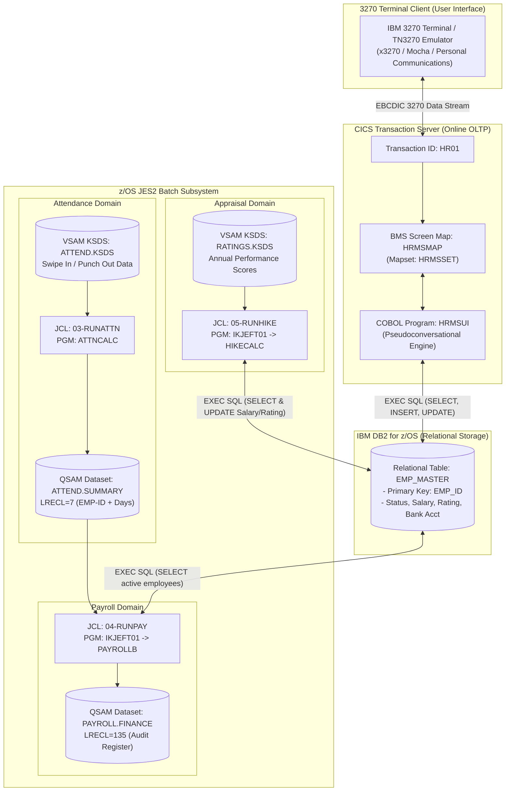
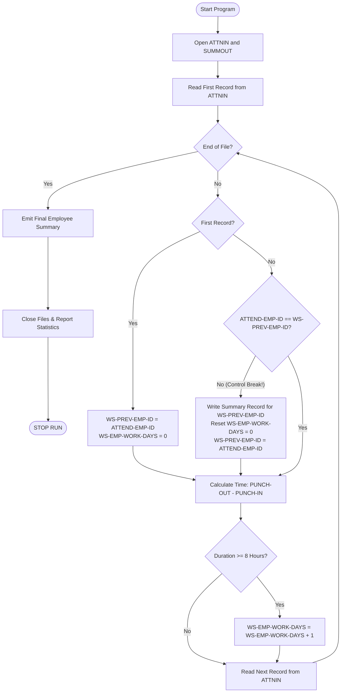
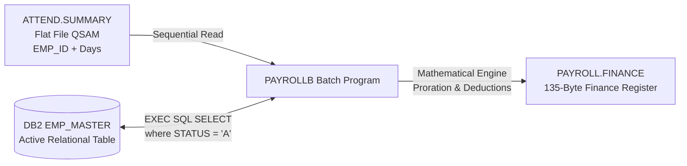

# Enterprise Mainframe HRMS: System Architecture & Design Specification

Welcome to the architectural blueprint of the **Enterprise Mainframe Human Resource Management System (HRMS)**. This document is tailored for developers, system architects, and beginners transitioning from modern distributed computing to IBM z/OS enterprise systems.

---

## 1. High-Level Architecture Overview

The Enterprise Mainframe HRMS combines high-throughput online transaction processing (**OLTP**) via IBM CICS Transaction Server and high-volume scheduled batch processing (**Batch**) via Job Control Language (JCL), Enterprise COBOL, and IBM DB2.



---

## 2. Online Subsystem (CICS / DB2 Pseudoconversational Architecture)

In mainframe enterprise systems, tens of thousands of concurrent terminal users access transactions simultaneously. CICS avoids holding system memory while a user is typing by using **Pseudoconversational Programming**.

### Execution Lifecycle:
1. **Initial Entry**: User types `HR01` and presses `ENTER`.
   - CICS inspects `EIBCALEN` (Length of Communication Area).
   - Because `EIBCALEN = 0`, `HRMSUI` recognizes a fresh session.
   - It sends the initial screen (`EXEC CICS SEND MAP('HRMSMAP') ERASE`) and immediately **terminates execution** (`EXEC CICS RETURN TRANSID('HR01') COMMAREA(...)`).
   - *System resources are released while the user reads or types.*
2. **User Interaction**: User enters an Action code (`S`, `I`, `U`, `D`, `C`, `X`) and fields, then presses `ENTER`.
3. **Continuation**: CICS reloads `HRMSUI`, passing the previous conversation state in `DFHCOMMAREA` (`EIBCALEN > 0`).
   - The program calls `EXEC CICS RECEIVE MAP('HRMSMAP')`.
   - Evaluates the user Action.
   - Executes SQL statements against `EMP_MASTER`.
   - Sends the updated map back (`DATAONLY CURSOR`) with status messages.
   - Re-arms the transaction with `RETURN TRANSID('HR01')`.

```mermaid
sequenceDiagram
    autonumber
    actor User as HR Operator (3270 Terminal)
    participant CICS as CICS Transaction Server
    participant COBOL as HRMSUI Program
    participant DB2 as IBM DB2 (EMP_MASTER)

    User->>CICS: Types 'HR01' & presses [ENTER]
    CICS->>COBOL: Invokes HRMSUI (EIBCALEN = 0)
    COBOL->>CICS: SEND MAP('HRMSMAP') ERASE
    COBOL->>CICS: RETURN TRANSID('HR01') COMMAREA(...)
    CICS-->>User: Screen displayed; Task ends (0 resources held)

    User->>CICS: Enters Action 'S', EMP_ID 'E0001', presses [ENTER]
    CICS->>COBOL: Invokes HRMSUI (EIBCALEN > 0)
    COBOL->>CICS: RECEIVE MAP('HRMSMAP')
    COBOL->>DB2: EXEC SQL SELECT ... WHERE EMP_ID = 'E0001'
    DB2-->>COBOL: Returns Employee Record (SQLCODE = 0)
    COBOL->>CICS: SEND MAP('HRMSMAP') DATAONLY (Formatted fields + Message)
    COBOL->>CICS: RETURN TRANSID('HR01') COMMAREA(...)
    CICS-->>User: Updated screen displays employee data
```

### Soft-Delete Pattern
Corporate HR records must never be permanently deleted because historical payroll and tax audits require record continuity. When the operator enters Action `D`:
- The program **never** executes `EXEC SQL DELETE FROM EMP_MASTER`.
- Instead, it performs an audit-compliant **Soft Delete**:
  ```sql
  UPDATE EMP_MASTER 
  SET STATUS = 'I', 
      LAST_WORKING_DAY = CURRENT DATE 
  WHERE EMP_ID = :EMP-ID AND STATUS = 'A';
  ```
- This immediately deactivates the employee from active payroll while preserving their history.

---

## 3. Batch Attendance Domain (Control Break Engine)

Batch processing requires processing millions of records with predictable memory footprint ($O(1)$ space complexity). `ATTNCALC.cbl` implements the classic **Single-Level Control Break Pattern**.



### Shift Math Algorithm:
- Input timestamps are formatted as `HHMMSS` (6 bytes).
- Program calculates:
  $$\text{Minutes}_{\text{In}} = (\text{HH}_{\text{In}} \times 60) + \text{MM}_{\text{In}}$$
  $$\text{Minutes}_{\text{Out}} = (\text{HH}_{\text{Out}} \times 60) + \text{MM}_{\text{Out}}$$
  $$\Delta \text{Minutes} = \text{Minutes}_{\text{Out}} - \text{Minutes}_{\text{In}}$$
- If $\Delta \text{Minutes} \ge 480$ (8 hours), the punch qualifies as 1 full working day.

---

## 4. Batch Payroll & Compensation Pipeline

The payroll engine (`PAYROLLB.cbl`) integrates flat file outputs with DB2 relational tables.



### Mathematical Formulation:
1. **Attendance Bound**: $\text{Days Worked} = \min(\text{OUT-TOTAL-DAYS}, 30)$
2. **Loss of Pay (LOP) Days**: $\text{LOP Days} = 30 - \text{Days Worked}$
3. **Proration Factor**: $\text{Ratio} = \frac{\text{Days Worked}}{30.0}$
4. **Earnings Allocation**:
   - $\text{Basic Earned} = (\text{Base Salary} \times 0.50) \times \text{Ratio}$
   - $\text{HRA Earned} = (\text{Base Salary} \times 0.30) \times \text{Ratio}$
   - $\text{Allowances Earned} = (\text{Base Salary} \times 0.20) \times \text{Ratio}$
   - $\text{Gross Pay} = \text{Basic Earned} + \text{HRA Earned} + \text{Allowances Earned}$
5. **Deductions & Net Pay**:
   - $\text{PF Deduction} = \text{Basic Earned} \times 0.12$
   - $\text{Net Pay} = \text{Gross Pay} - \text{PF Deduction}$

---

## 5. Annual Performance Hike Pipeline

The appraisal engine (`HIKECALC.cbl`) reads appraisal scores from `RATINGS.KSDS` and updates DB2 relational records.

| Performance Rating | Hike % Applied | Salary Adjustment Formula |
|:---:|:---:|:---|
| **5 (Outstanding)** | **15%** | $\text{New Salary} = \text{Old Salary} \times 1.15$ |
| **4 (Exceeds Expectations)** | **10%** | $\text{New Salary} = \text{Old Salary} \times 1.10$ |
| **3 (Meets Expectations)** | **5%** | $\text{New Salary} = \text{Old Salary} \times 1.05$ |
| **1 or 2 (Needs Improvement)** | **0%** | Salary unchanged |

Upon completion, an explicit `EXEC SQL COMMIT` guarantees ACID transactional permanence in DB2.
